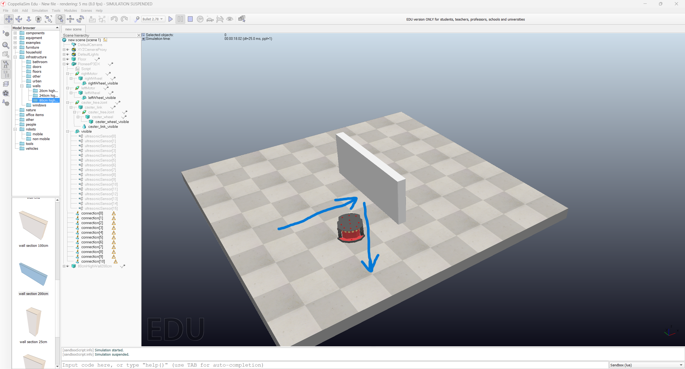
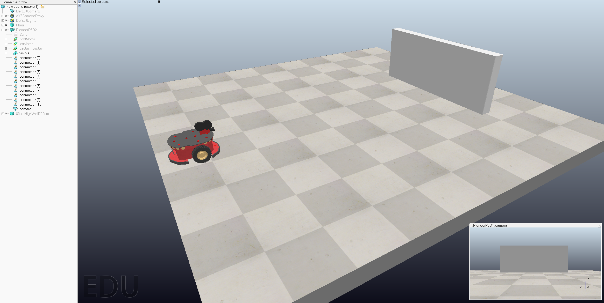
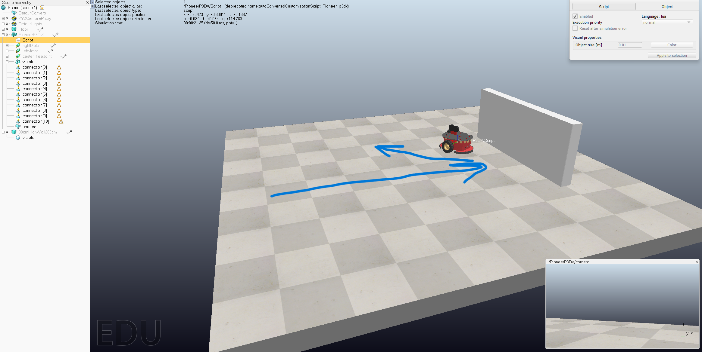
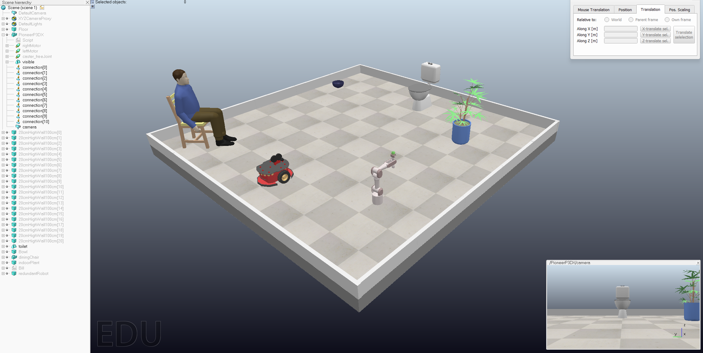

# СПм-25-1, Олешко Владислав Миколайович

## Лабораторна робота №4. Моделювання у середовищі CoppeliaSim

## Варіант 1.
Модифікація вихідного коду таким чином, щоб при зустрічі з перешкодою робот повератав ліворуч (увага на алгоритм Брайтенбергу та відповідні набори значень у коді). Додати на сцену випадковий набір із п'яти перешкод, розташувавши їх відповідно до руху робота.

### Мета роботи
Ознайомитись із можливостями середовища робототехнічного моделювання CoppeliaSim. Використовувати існуючі моделі та компоненти, отримати навички корегування логіки їхньої роботи. Отримати уявлення про синтакс мови Lua.

### Виконання роботи:
Додаю на пусту сцену робота pioneer p3dx з розділу robots - mobile та вивчаю базові елементи керування, що дозволяють запускати симуляцію, ставити її на паузу, повністю її скидати та змінювати швидкість. Використовуючи інтерфейс верхньої частини екрану вивчаю основні елементи для переміщення об'єкта дослідження у сцені.

Базова закладена поведінка обраного робота - уникати перешкод завдяки наявним датчикам. Для перевірки цього додаю двометрову стіну перед роботом та перевіряю. Після запуску симуляції та досягнення стіни, робот зупиняється ненадовго, повертається в сторону приблизно на 130 градусів та продовжує рух. За відсутності інших перешкод - рух у напрямку кінця сцени, до падіння з неї.

Додаємо камеру, пересуваємо її на робота. Додаємо floating view та асоціюємо його з доданою камерою.

Стандартний скрипт робота змушує його повертати праворуч за умови наявності перешкоди чітко за курсом. Відповідно по вимог варіанту лабораторної роботи, я змінюю вихідний код, щоб робот майже завжди повертав ліворуч. Для цього потрібно встановити інші значення у масивах `braitenbergL` та `braitenbergR`.

<pre>
  braitenbergL={-0.2, -0.4, -1.4, -1.6, -1.6, -1.4, -1.4, -1.6, 0.0,0.0,0.0,0.0,0.0,0.0,0.0,0.0}
  braitenbergR={-0.8, -0.6, -0.4, -0.0, -0.0, -0.2, -0.4, -0.2, 0.0,0.0,0.0,0.0,0.0,0.0,0.0,0.0}
</pre>

Кожне число масива відповідає за рух колеса при спрацьовуванні одного із датчиків. Всього їх 16, відповідно по 8 спереду та позаду. Підбираю числа у масивах так, щоб ліве колесо гальмувало сильніше за праве, що призводить до повороту саме у ліву сторону.

Тепер за незмінної стартової позиції (тільки стіна стала далі), робот повертає в іншу сторону досягаючи перешкоди.

Далі додаю п'ять різних об'єктів, які будуть траплятись на шляху руху робота. Фінальна сцена виглядає так.

Бонусом я маю бажання внести одну зміну від себе. Для цього оновлюю скрипт робота, щоб виводити у термінал кількість перешкод, які зустрічає робот на шляху. Потрібно додати два блоки коду до двох наявних методів. У `sysCall_init()` оголошуємо 3 нові змінні.

<pre>
  obstacleCount = 0      -- скільки перешкод зустрінуто
  obstacleSeen = false   -- чи бачимо перешкоду зараз
  lastSeenTime = 0       -- коли востаннє бачили перешкоду (сек симуляції)
</pre>

У `sysCall_actuation()` додаємо цикл, який буде використовувати нові зміни та виводити інформацію у термінал.

<pre>
  local frontDetect = math.max(detect[3], detect[4], detect[5], detect[6])
  local t = sim.getSimulationTime()
  if frontDetect > 0.3 then
      if not obstacleSeen then
          obstacleSeen = true
          obstacleCount = obstacleCount + 1
          print('I SAW OBSTACLES: ' .. obstacleCount)
      end
      lastSeenTime = t
  elseif obstacleSeen and (t - lastSeenTime > 1.0) then
      obstacleSeen = false
  end
</pre>

Для детекції використовуємо лише фронтальні датчики `3, 4, 5, 6`, щоб не рахувати повторно об'єкти які опинились збоку після об'їзду. `frontDetect > 0.3` дозволяє ігнорувати об'єкти, які можуть потрапляти у зону видимості, але все ж не бути прямо на шляху. `if not obstacleSeen then` - змінюємо `obstacleSeen` на `true` лише якщо до цього значення було `false`. Далі звичайним інкрементом збільшуємо лічильник перешкод та виводимо повідомлення в термінал. В кінці важливо повернути значення `obstacleSeen` до `false`, але робити це треба не одразу, інакше потрапимо у цикл. Щоб не допустити цього - на початку фіксуємо поточний час симуляції (`local t = sim.getSimulationTime()`), після зустрічі з перешкодою записуємо поточний час у нову змінну `lastSeenTime`, а далі перевіряємо чи пройшла 1 секунда від останнього разу, коли зустріли перешкоду - `t - lastSeenTime > 1.0`. Якщо всі умови виконались - переставляємо `obstacleSeen` у `false`.

### Висновок
Під час виконання лабораторної роботи я ознайомився із середовищем моделювання CoppeliaSim: роботою з ієрархією об'єктів сцени, додаванням готових моделей (робот Pioneer P3DX, перешкоди), камери та вікна Floating view, а також налаштуванням деяких властивостей об'єктів. На практиці розглянуто алгоритм Брайтенберга: як коефіцієнти зв'язків між ультразвуковими датчиками та колесами визначають поведінку робота. Змінивши набори коефіцієнтів так, щоб ліве колесо гальмувало сильніше за праве, я забезпечив поворот робота ліворуч при зустрічі з перешкодою й перевірив це на сцені з п'ятьма перешкодами. Додатково поліпшив навички роботи з мовою Lua додавши підрахунок кількості перешкод на шляху робота та їх виведення у термінал.
